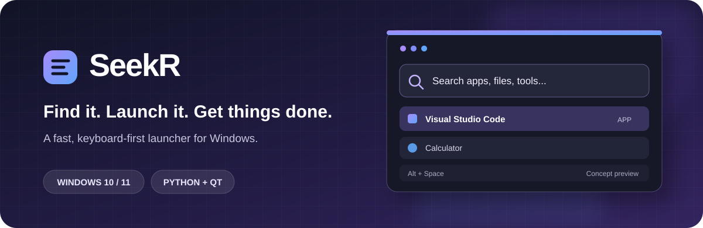

<div align="center">



<br>

[](https://github.com/okyanus-11/SeekR/releases/latest)
[](https://github.com/okyanus-11/SeekR/actions/workflows/ci.yml)
[](LICENSE)
[](#requirements)

<br>

<a href="https://github.com/okyanus-11/SeekR/releases/latest"></a>

<br>
<sub><a href="https://github.com/okyanus-11/SeekR/releases">Releases</a> · <a href="CHANGELOG.md">Changelog</a> · <a href="docs/INSTALLATION.md">Install guide</a> · <a href="docs/TROUBLESHOOTING.md">Troubleshooting</a> · <a href="https://github.com/okyanus-11/SeekR/issues">Issues</a></sub>

<br><br>

<kbd>Alt</kbd> + <kbd>Space</kbd> &nbsp; → &nbsp; Type anything &nbsp; → &nbsp; <kbd>Enter</kbd>

</div>

---

## Your desktop, one shortcut away.

**SeekR is a keyboard-first launcher for Windows.** Open apps, find files, run commands, and reach useful tools from one fast dropdown — without breaking your flow.

Press `Alt + Space`, start typing, and let fuzzy search find what you mean. SeekR stays out of the way until you need it.

<div align="center">

| **LAUNCH** | **SEARCH** | **GET THINGS DONE** |
|:---:|:---:|:---:|
| Apps, commands and workflows | Files, folders and the web | Calculations, notes and system tools |

</div>

## What you can do

<table>
<tr>
<td width="50%" valign="top">

### ⚡ Launch at speed
- Global hotkey: `Alt + Space` by default
- Top-anchored dropdown on the active display
- Fuzzy matching with typo tolerance
- Recent and frequent result ranking
- Keyboard-first result and action navigation

</td>
<td width="50%" valign="top">

### 🔎 Find almost anything
- Start Menu apps and custom app folders
- Indexed files and folders
- Optional text-content search in chosen roots
- Browser bookmarks
- Calculator expressions
- Web, Wikipedia, YouTube and GitHub search

</td>
</tr>
<tr>
<td width="50%" valign="top">

### 🧰 Built-in tools
- Calculator, dictionary, translation and unit conversion
- JSON, Base64, URL, regex, hash and color utilities
- Screenshots, system information and process inspection
- Clipboard history, notes and bookmarks
- Tasks, snippets, workflows and command chains
- SSH profiles with Windows OpenSSH, window management and power actions
- Database backup, restore and diagnostics

</td>
<td width="50%" valign="top">

### 🎛️ Make it yours
- Graphite, Light, AMOLED, Catppuccin Mocha, Dracula and Nord themes
- Custom accent color and typography
- Adjustable launcher size and widget layout
- Configurable hotkey, search behavior and refresh intervals
- Reduced-motion option and keyboard-focus styling
- Stable, opaque launcher surface for reliable desktop rendering

</td>
</tr>
</table>

## The launcher widgets

Optional cards sit beside the search results. Enable only the ones you want, adjust their size and refresh intervals, and reorder the two rails.

| Widget | What it shows |
|---|---|
| **Clock** | Local time, date and a configurable focus timer |
| **System** | CPU, memory, storage, battery and network activity |
| **Weather** | Current conditions for a configured location |
| **Daily cat** | A cat photo displayed inside SeekR and cached locally |
| **Media** | Current Windows media session and playback controls, where supported |
| **Tasks** | A compact summary of open and overdue local tasks |

Weather uses [Open-Meteo](https://open-meteo.com/). Cat photos come from [TheCatAPI](https://thecatapi.com/). Network-backed cards fetch in the background and retain useful cached content when a refresh fails. Fresh network data requires an internet connection.

## Search that feels natural

Type a name, phrase or keyword prefix. Here are a few examples:

| Query | Result |
|---|---|
| `discord` | Find an installed application |
| `file: invoice` | Search indexed files |
| `content: setup guide` | Search configured text-file contents |
| `calc: sqrt(144) + 25 * 4` | Calculate an expression |
| `web: Raspberry Pi 5` | Search the configured web engine |
| `wiki: ESP32` | Search Wikipedia |
| `yt: DOOM soundtrack` | Search YouTube |
| `gh: embedded projects` | Search GitHub |
| `define: algorithm` | Look up a definition |
| `translate: Hello to Turkish` | Open a translation |
| `unit: 100 km to miles` | Convert units |
| `time: Tokyo` | Look up local time |
| `sys:` | Show system information |
| `comm: ipconfig` | Run a built-in command |
| `flow: prepare work` | Find and run a workflow |
| `snip: signature` | Find a saved snippet |
| `chain: taskmgr then explorer` | Run a command chain |
| `task: installer` | Search local tasks |
| `wm: minimize all` | Manage application windows |
| `update: check` | Check official SeekR releases |

Prefixes are case-insensitive. Without a prefix, SeekR can also recognize calculator expressions and rank matching apps and files.

## Keyboard shortcuts

| Shortcut | Action |
|---|---|
| `Alt + Space` | Show or hide SeekR |
| `↑` / `↓` | Move through results |
| `Page Up` / `Page Down` | Move six rows |
| `Enter` | Run the selected result's primary action |
| `Tab` / `Shift + Tab` | Cycle through available actions |
| `Ctrl + 1…9` | Run an action by position |
| `Ctrl + ,` | Open Settings |
| `Ctrl + T` | Open Tools |
| `Ctrl + R` | Re-index apps and files |
| `Esc` | Clear action selection, then hide |
| Right-click a result | Open its context menu |

If another application already owns `Alt + Space`, choose a different combination in **Settings → General**.

## Get started

1. Open the **[latest release](https://github.com/okyanus-11/SeekR/releases/latest)**.
2. Download `SeekR-Setup-<version>.exe` for a per-user installation, or `SeekR.exe` for the portable build.
3. Launch SeekR and press **Alt + Space**.
4. Search for an app, try `calc: 42 * 42`, or explore **Tools**.

The installer does not require administrator privileges or a separate Python installation. It creates a Start Menu shortcut. Uninstalling removes the application but preserves your local SeekR data.

**New to SeekR?** Start with the [installation guide](docs/INSTALLATION.md). If something goes wrong, see [troubleshooting](docs/TROUBLESHOOTING.md).

## Privacy by design

SeekR keeps its working data on your device. Configuration, database, logs, notes and optional clipboard history are stored locally.

- Clipboard monitoring is **off by default** and requires opt-in.
- Clipboard text and optional PNG captures are stored locally **without encryption**.
- Turning monitoring off stops future capture; clear saved history separately.
- Sensitive-content detection is heuristic, not a guarantee that every secret will be caught.
- Application usage ranking and file-content search are opt-in.
- Diagnostics reports are generated only when requested and are not uploaded. Logs are excluded by default; redaction is best-effort.
- Update checks read official GitHub release metadata. Downloads and installation remain explicit user actions.

On Windows, user data lives under `%APPDATA%\\SeekR`. Uninstalling the app preserves this folder. Keep backups private.

## Requirements

| | |
|---|---|
| **Supported desktop OS** | 64-bit Windows 10 / Windows 11 |
| **End-user setup** | Installer or portable executable; Python not required |
| **Development** | Python 3.10+ (Python 3.12 recommended) |
| **Core stack** | Python · PySide6 · SymPy · psutil · SQLite |

Linux is used in CI for source-mode testing and development; it is not currently a supported end-user desktop platform. macOS is not supported or tested.

## Localization

The launcher shell and shared navigation are available in English, Turkish, Spanish, French, German, Italian, Brazilian Portuguese, Japanese and Simplified Chinese. Localization is partial; some longer descriptions, tool content, dialogs and dynamic messages may remain in English.

## Development

```powershell
git clone https://github.com/okyanus-11/SeekR.git
cd SeekR
py -3.12 -m venv .venv
.\.venv\Scripts\Activate.ps1
python -m pip install -r requirements-dev.txt
python main.py
```

Run the tests:

```bash
python -m pytest -q
```

For headless Linux:

```bash
QT_QPA_PLATFORM=offscreen python -m pytest -q
```

Build a Windows executable:

```powershell
python build.py
```

See [Architecture](docs/ARCHITECTURE.md) for the codebase overview and [Installation](docs/INSTALLATION.md) for packaging details.

## Release status

**Latest published release: v2.0.2.** The main branch contains post-release maintenance changes that are not included in the v2.0.2 installer or portable download. The main-branch workflow runs the test suite on Windows and Ubuntu, builds the Windows packages, and verifies a fresh installation; those checks do not retroactively change the published v2.0.2 assets.

Automated checks are not a substitute for testing on a real desktop. Mixed-DPI and multi-monitor behavior, sleep/resume, upgrading from an older installer while preserving user data, accessibility, and long-duration interactive stability still require hands-on validation. Follow the open [Windows post-release checklist](https://github.com/okyanus-11/SeekR/issues/1) for what remains. Windows executables are currently unsigned and may trigger a SmartScreen warning.

## Contributing

Bug reports and practical suggestions are welcome. Check [existing issues](https://github.com/okyanus-11/SeekR/issues) before opening a new one. Include reproduction steps and environment details, but never attach passwords, private clipboard contents or personal notes.

## License

SeekR is released under the [MIT License](LICENSE).

<div align="center">

---

**Less searching. More doing.**

<sub>Made with Python, PySide6, SymPy, psutil and SQLite.</sub>

<br>

<a href="https://github.com/okyanus-11/SeekR/releases/latest">Download SeekR</a> · <a href="https://github.com/okyanus-11/SeekR/issues">Report an issue</a> · <a href="CHANGELOG.md">Changelog</a>

</div>
